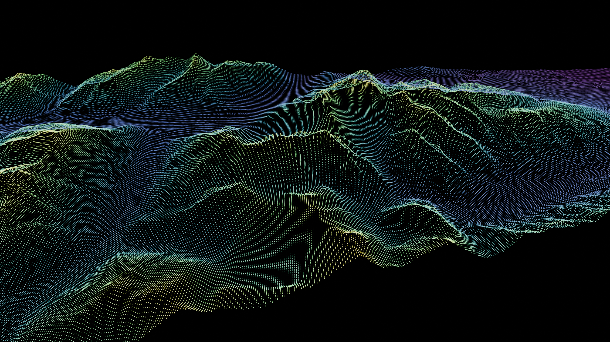
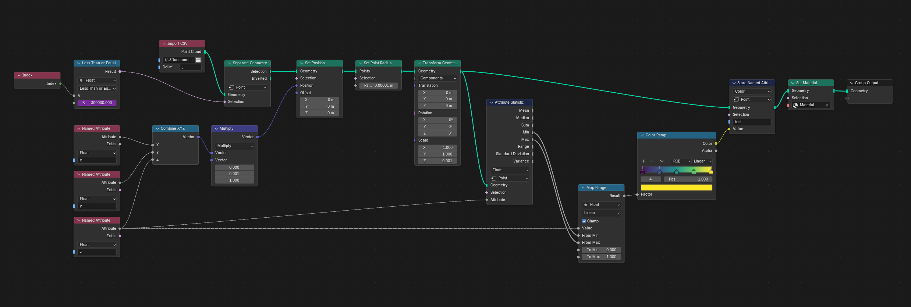

# GIS Project
[Remote sensing data workflow and visualization using Environment Canada satellite data.] 

## About the Project

## Python Workflow
### Corbel Spatial Geospatial Wheels Index
**GitHub**: [Corbel Spatial Wheels](https://github.com/corbel-spatial/geospatial-wheels-index)

## Blender Simulation

## Data Citation
### OpenTopography Dataset
**Dataset**: [OpenTopography](https://portal.opentopography.org/result?id=rt1789275687841) 
**Dataset Citation**: Natural Resources Canada (2025).  Medium Resolution Digital Elevation Model of Canada.  Distributed by OpenTopography. https://doi.org/10.5069/G9N8780J. Accessed 2026-09-13  
**Use License**: Open Government Licence - Canada 

### Copernicus Sentinel 2 Dataset
**Dataset**: [Copernicus Browser](https://browser.dataspace.copernicus.eu/?zoom=13&lat=50.6407&lng=-128.10591&themeId=DEFAULT-THEME&visualizationUrl=U2FsdGVkX18h%2FcR5Do5UvGinMxbdtN4leg7QI2sHQ4%2BvQTDIZZyhCzuFrMWnNmgdbCq1FT32fkNAE5qb5IVIViayBzIDc7PhCwhZ%2BmdV727dfQYxt3q1ilfJ4kzAGaYD&datasetId=S2_L2A_CDAS&fromTime=2026-09-15T00%3A00%3A00.000Z&toTime=2026-09-15T23%3A59%3A59.999Z&layerId=2_FALSE_COLOR&demSource3D=%22MAPZEN%22&cloudCoverage=30&dateMode=SINGLE&panel=layers) 
**Dataset Citation**:  European Space Agency. (2026). Copernicus Sentinel-2 data 2026. Retrieved from the Copernicus Data Space Ecosystem Browser. Product ID: S2A_MSIL2A_20260918T191831_N0512_R056_T10UDV_20260919T014720. 
**Use License**:  Copernicus Free, Full, and Open Data Policy. Attribution: "Contains modified Copernicus Sentinel data 2026."

### EarthEngine Datasets
#### Dynamic World V1 Dataset
**Dataset**: [Dynamic World V1](https://developers.google.com/earth-engine/datasets/catalog/GOOGLE_DYNAMICWORLD_V1#description) 
**Dataset Name**: dynamic_world_20260918_T10UDV.tif 
**Dataset Citation**: Brown, C.F., Brumby, S.P., Guzder-Williams, B. et al. Dynamic World, Near real-time global 10 m land use land cover mapping. Sci Data 9, 251 (2022). doi:10.1038/s41597-022-01307-4 
**Use License**: This dataset is licensed under CC-BY 4.0 and requires the following attribution: "This dataset is produced for the Dynamic World Project by Google in partnership with National Geographic Society and the World Resources Institute."
Contains modified Copernicus Sentinel data [2015-present].

#### Landsat Dataset
**Dataset**: [USGS Landsat 9 Level 2, Collection 2, Tier 1](https://developers.google.com/earth-engine/datasets/catalog/LANDSAT_LC09_C02_T1_L2?_gl=1*k8hbmi*_up*MQ..*_ga*MTI0MTQzODAxMS4xNzkxNzUwNzk3*_ga_SM8HXJ53K2*czE3OTE3NTA3OTYkbzEkZzAkdDE3OTE3NTA3OTYkajYwJGwwJGgw#terms-of-use) 
**Dataset Name**: LC09_048026_20260915.tif 
**Dataset Citation**: Landsat-9 image courtesy of the U.S. Geological Survey (Asset: LC09_048026_20260915). 
**Use License**: Public Domain (U.S. Government Work). Attribution: "Landsat data resides in the public domain and may be used without copyright restriction. Credit courtesy of the U.S. Geological Survey."
