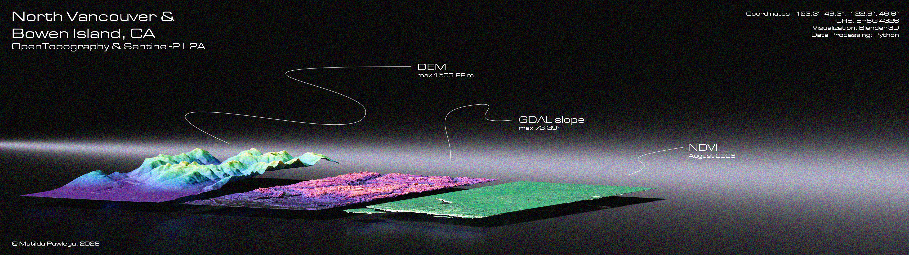
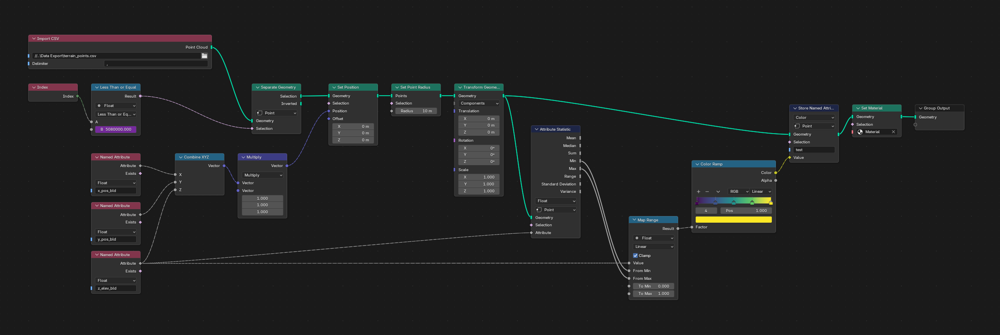
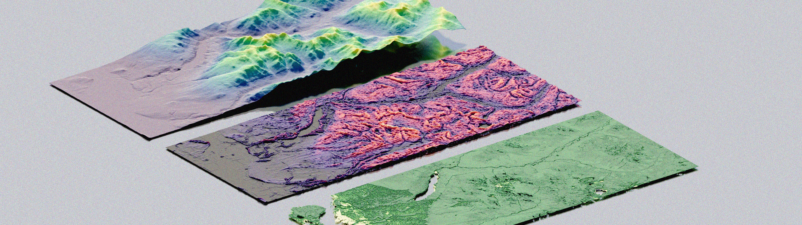
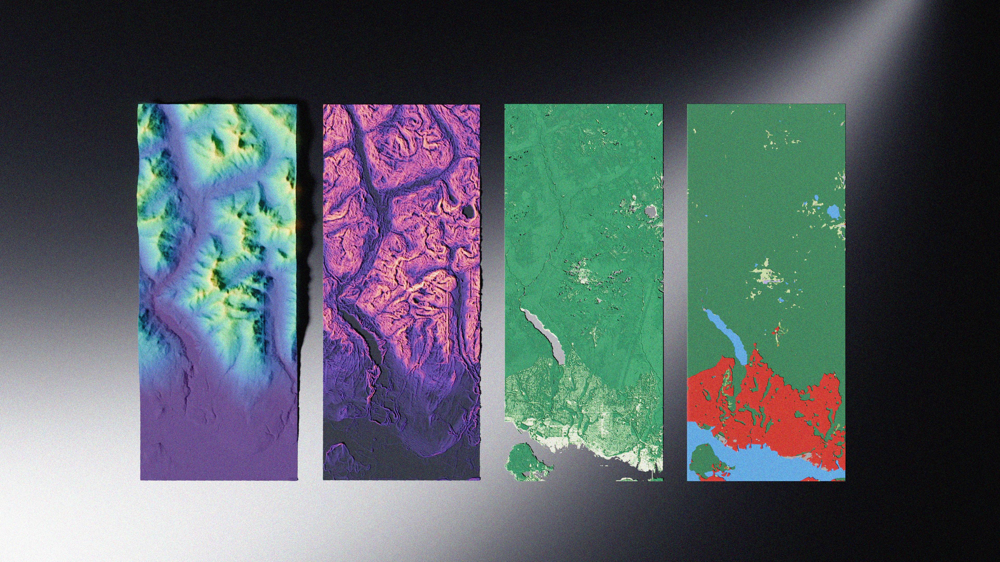

# Remote Sensing Project

## About the Project 
This project uses Sentinel-2 L2A composite bands, OpenTopography digital elevation models (DEMs), and Dynamic World V1 land cover labels. The goal was to understand August NDVI changes between 2024 and 2026 using change statistics and machine learning clustering models. The ROI spans Northern Vancouver, nearing Bowen Island and UBC campus. Data cleaning and statistical analysis were performed using Python and documented in Jupyter notebooks. Datasets were sourced through Google Earth Engine and OpenTopography as cited under [Citations](#data-citations). Data visualizations were created in Blender 3D to explore alternative visualization methods suited for science communication, marketing, and technological art.

## Environment Setup and Dependencies:
### Corbel Spatial Geospatial Wheels Index
The wheels index was used as a supplement for missing dependencies after installing GDAL and osgeo libraries with pip. See the source linked.   
**GitHub**: [Corbel Spatial Wheels](https://github.com/corbel-spatial/geospatial-wheels-index)

### Google Earth Engine
Harmonized Sentinel-2 L2A products were queried from Google Earth Engine (GEE) for more efficient data cleaning, pixel masking, and data export. This simplified batch processing for composites and reduced the need to clean previously downloaded Copernicus Browser data (i.e. BOA, offsets, etc.). Datasets were SCL-masked prior to export, packaged into GeoTIFF formats and stored in Google Drive. I used GEE to gain exposure to different queries and authentication for batch processing, rather than relying on heavy Copernicus Browser files. See [`earth_engine_data.ipynb`](earth_engine_data.ipynb.ipynb) for Sentinel-2 L2A and Dynamic World V1 queries.

### Python Libraries 
- **Geospatial & Remote Sensing**: rasterio, GDAL (via osgeo), pyproj, shapely, affine, earthengine-api (ee)
- **Data Analysis & Machine Learning**: numpy, pandas, scipy, scikit-learn (sklearn)
- **Visualization**: matplotlib, seaborn
- **API & Notebook Utilities**: requests, ipython

## Data Workflow
### Python Data Preparation and Cleaning
Data saved under [`Datasets`](Datasets) in GeoTIFF format were loaded using rasterio to grab band data and metadata to check NoData values and bounds, resolution, and coordinate reference system. Data was masked accordingly for NoData values to NaN. I used the 10 m Sentinel-2 L2A grid as the reference grid for reprojection, and cropped the data to match the DEM AOI. GDAL was used to calculate slope products from the DEM. Sentinel dataset loading was automated to handle multiple rasters, using dictionaries to store metadata and band-level data. Each dataset was plotted using matplotlib for validation checks. See [`data_cleaning.ipynb`](data_cleaning.ipynb) section **Data Cleaning** for full workflow. 

### K-means and Statistical Analysis
Preliminary analysis for NDVI, elevation, and slope statistics was performed under a shared validity pixel mask. NumPy and SciPy libraries were used to understand distributions, anomalies, and Pearson correlations between datasets. Composites created for August NDVI were compared across 2024 to 2026, with a separate shared validity pixel mask. Change statistics were quantified in NDVI difference plots based on pixel counts above NDVI change thresholds. Change statistics were tabulated using pandas dataframes for efficient visual reference. See [`data_cleaning.ipynb`](data_cleaning.ipynb) section **Temporal NDVI Change Statistics**.

Unsupervised learning such as K-means clustering was used on both NDVI and DEM rasters. For each NDVI composite year, K-means clusters were detected from a combined feature set to visualize cluster change. K-means was run on a combined feature set, including NDVI, elevation, and slope, to understand any correlation between the DEM and NDVI between years. See [`data_cleaning.ipynb`](data_cleaning.ipynb) sections **K-Means Clustering and Correlation** and **K-Means NDVI Clustering** for more details.

###  RandomForest (WIP)

### Analysis Results (WIP) 

## Data Exports for QGIS and Blender Visualizations (WIP)
Datasets were exported as GeoTIFF and CSV formats for further analysis and visual work. See [`blender_and_band_exports.ipynb`](./blender_and_band_exports.ipynb), note that in [`Data Export/blender_inputs.npz`](./Data%20Export/blender_inputs.npz) and [`Data Export/export_inputs.npz`](./Data%20Export/export_inputs.npz) were created to store and load data from [`data_cleaning.ipynb`](data_cleaning.ipynb), which is a separate notebook to keep data cleaning and exports separate. As a check, the GeoTIFF was loaded into QGIS to validate UTM bounds, pixel values, resolution, and correct band order. The GeoTIFF is stored under [`Data Export/export_bands.tif`](./Data%20Export/export_bands.tif).

Data exports into Blender include position, elevation, slope, and Dynamic World labels as separate columns. Data was plotted as point clouds to mimic the style of LiDAR data as a visual preference. These renders are stylized data visualizations more suited for scientific communication or marketing compared to the analysis plots. Blender geometry nodes were used to unpack data and load points using point cloud geometry nodes, attribute statistics, and colour ramps. The node *Separate Geometry* has an input for selection, where the bounds are the index from the CSV and a frame driver to reveal the points as the timeline plays. The image below (i.e., [`Assets/Edited Renders/geometry_nodes.png`](./Assets/Edited%20Renders/geometry_nodes.png)) shows the workflow for the DEM, using viridis as the cmap, and *z_elev_bld* and the elevation value. The full workflow is stored under [`Assets/GIS_geometry_nodes_workflow_3_set.blend`](./Assets/GIS_geometry_nodes_workflow_3_set.blend). 

 

Several visualizations were created and stored under [`Assets/Edited Renders/`](./Assets/Edited%20Renders/). Of these, my favourite picks are displayed below. Please note the NDVI and slope plots have been exaggerated for visual effect in orthographic views (slope: [0°, 73°], NDVI: [-1, 1], elevation: [0 m, 1492 m]). The exported data has a shared validity mask between all NDVI dates and the DEM, accounting for visual gaps, as imputation methods were not used (yet).   

 
 

## Future Work
Additional exploratory work investigated LiDAR and Landsat in the ROI; these are not included in the main analysis. Future expansions may include the following:
- Using LiDAR point cloud data to visualize finer-resolution details and expand on the existing Blender visualization. Alternatively, .LAZ point clouds will be visualized using Potree or Innerscene tools for validation checks. 
- A comprehensive temporal analysis using openEO or similar time-series libraries will be used to expand the current temporal analysis. 
- Understanding imputation and interpolation methods for NoData, bad pixels, shadows, or varying illumination angles. 
- Understand correlation between temporal NDVI, Landsat temperature fluctuations, and fill sinks. 
- Further exposure to batch processing and conversion of Jupyter notebooks to .py for workflow optimization (i.e., [`earth_engine_data.ipynb`](./earth_engine_data.ipynb) and [`blender_and_band_exports.ipynb`](./blender_and_band_exports.ipynb)). 
- Create labelled data visualizations and animations with key statistics for terrain AOI.

## Data Citations
### Earth Engine Datasets
#### Dynamic World V1 Dataset
**Dataset**: [Dynamic World V1](https://developers.google.com/earth-engine/datasets/catalog/GOOGLE_DYNAMICWORLD_V1#description) 
**Dataset Name**: dynamic_world_20260807_T10UDV.tif 
**Dataset Citation**: Brown, C.F., Brumby, S.P., Guzder-Williams, B. et al. Dynamic World, Near real-time global 10 m land use land cover mapping. Sci Data 9, 251 (2022). doi:10.1038/s41597-022-01307-4 
**Use License**: This dataset is licensed under CC-BY 4.0 and requires the following attribution: "This dataset is produced for the Dynamic World Project by Google in partnership with National Geographic Society and the World Resources Institute."
Contains modified Copernicus Sentinel data [2015-present].

#### Harmonized Sentinel-2 L2A MSI Dataset
**Dataset**: [Harmonized Sentinel-2 L2A MSI](https://developers.google.com/earth-engine/datasets/catalog/COPERNICUS_S2_SR_HARMONIZED#terms-of-use) 
**Dataset Name**: Multiple images from Harmonized Sentinel-2 MSI: MultiSpectral Instrument, Level-2A (SR), see EE filters in *earth_engine_data.ipynb*.  
**Dataset Citation**: European Union/ESA/Copernicus  
**Use License**: Terms and Conditions of the Copernicus Sentinel Data

### OpenTopography Dataset
**Dataset**: [OpenTopography](https://portal.opentopography.org/result?id=rt1789275687841) 
**Dataset Name**: CA_MRDEM 
**Dataset Citation**: Natural Resources Canada (2025).  Medium Resolution Digital Elevation Model of Canada.  Distributed by OpenTopography. https://doi.org/10.5069/G9N8780J. Accessed 2026-09-13  
**Use License**: Open Government Licence - Canada 

